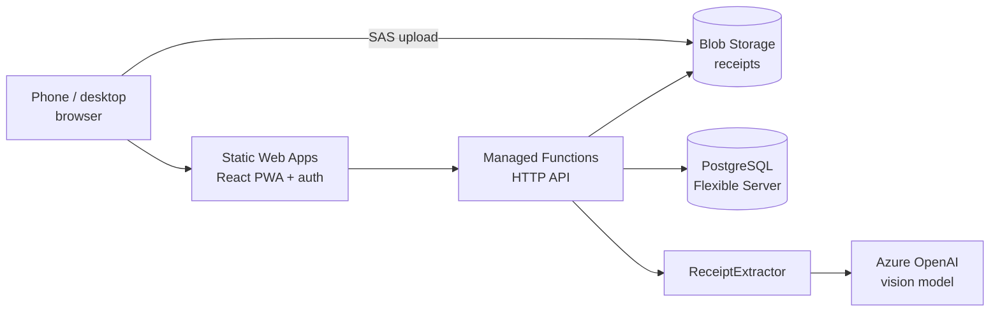

# Architecture Overview

Source of truth for Tanqueo's technical design. Product requirements live in [`docs/prd/PRD-v1.md`](../prd/PRD-v1.md); this document owns system structure, data flow and technical trade-offs.

Status as of 2026-09-29: **decision recorded, not yet implemented**. The repository contains only the default Vite + React scaffold (`src/App.tsx` is the unmodified `create-vite` template); none of the components below exist in code yet. Everything here is the confirmed target design from the source PRD, evidence-backed by its Architecture, Data model, and API sections. [Inferred from codebase: `package.json`, `src/`, `vite.config.ts`.]

## Technical Context

Tanqueo runs entirely on Azure in Canada Central: a React PWA on Static Web Apps (Free) with managed Functions as the API, PostgreSQL Flexible Server, Blob Storage and Azure OpenAI.

**Stack decision (confirmed 2026-09-29).** This Azure-based architecture is the vigente decision for Tanqueo. It supersedes, for this repository, the generic Next.js + Supabase default stack described in the ambient engineering `AGENTS.md` (which is not checked into this repository and functions as a personal cross-project template). See `AGENTES.md` at the repo root for the explicit, scoped override and what still applies from the generic defaults (naming conventions, component organization, UX rules, testing expectations) versus what does not (Next.js Route Handlers, `src/app/api/v{major}` routing, Supabase Auth/RLS, Prisma).

| Layer | Choice | Why |
| --- | --- | --- |
| Frontend | React + Vite + TypeScript, vite-plugin-pwa | Known stack; installable; SPA fits an app fully behind login |
| UI components | HeroUI v3 (`@heroui/react` + `@heroui/styles`, Tailwind CSS v4 + React Aria Components, no provider, compound components), theme "Rabbit" (custom, via HeroUI's Theme Builder) | Exclusive component library by explicit product decision — no custom/bespoke components except where HeroUI genuinely cannot solve a case (see [`ADR-0004`](../adr/ADR-0004-heroui-as-exclusive-component-library.md)) |
| Hosting | Azure Static Web Apps (Free) | Frontend + API deployed together from GitHub; built-in auth |
| API | SWA managed Functions (Node, TypeScript), HTTP triggers | No extra resources; enough for a household workload |
| Auth | SWA built-in (Microsoft, GitHub) | Zero config; household membership lives in our DB |
| Database | Azure Database for PostgreSQL Flexible Server, Burstable B1ms, 32 GB | Relational queries and window functions for consumption; portable; free for 12 months on the free account |
| Files | Blob Storage, private container, path `households/{householdId}/receipts/{receiptId}.jpg` | Cheap; direct upload via SAS |
| Extraction | Azure OpenAI vision model with structured outputs (JSON schema) | Reads varied receipt layouts without per-chain rules |
| Car data | NRCan Fuel Consumption Ratings (open data), imported once to a lookup table | Canadian L/100 km; no runtime dependency |
| Monitoring | Application Insights | Errors and extraction latency |

`vite-plugin-pwa` is not yet a dependency of `package.json`; FR-24 (PWA installability) is planned for Milestone M6. Neither is `@heroui/react` — see [`ADR-0004`](../adr/ADR-0004-heroui-as-exclusive-component-library.md) for the install steps to add before any UI work starts. [Inferred from codebase: `package.json` dependency list.]

## System Overview



The browser uploads photos straight to Blob Storage; the API only handles JSON and calls the extractor. This keeps the API stateless with respect to file payloads and avoids routing large binaries through Functions.

## Core Modules

**API surface.** A small JSON-over-HTTP surface under `/api`; every endpoint requires sign-in and resolves the household from the caller (never from the request body).

| Method | Path | Purpose |
| --- | --- | --- |
| GET | `/api/me` | User, household, members, active car |
| POST | `/api/invites` | Create invite link (owner) |
| POST | `/api/invites/{token}/accept` | Join a household |
| GET | `/api/vehicle-ratings?make&model&year` | Look up fuel type and official consumption |
| GET, POST | `/api/cars` | List and add cars |
| PATCH | `/api/cars/{id}` | Edit car |
| PUT | `/api/me/active-car` | Switch active car |
| POST | `/api/receipts` | Create receipt record, return SAS upload URL |
| POST | `/api/receipts/{id}/extract` | Run extraction, return fields and confidence |
| POST | `/api/fill-ups/check` | Duplicate check before save |
| POST | `/api/fill-ups` | Save; returns consumption and alert if any |
| GET | `/api/cars/{id}/fill-ups?month` | History, grouped by month |
| PATCH, DELETE | `/api/fill-ups/{id}` | Edit or delete (also marks one-off) |
| GET | `/api/cars/{id}/dashboard` | All dashboard figures in one response |

This is a flat Functions API, not Next.js Route Handlers — `AGENTS.md`'s API Policy section (`src/app/api/v{major}/...`, REST versioning headers, `Idempotency-Key`, etc.) was written for a Next.js backend and does not apply verbatim here. Apply its spirit (validate all input server-side with Zod, one predictable error shape, no unversioned public contract) but express it through the Functions project structure in `docs/architecture/project-structure.md`. `[Open question: no API versioning scheme (e.g. `/api/v1/...`) exists yet in the PRD's endpoint table — decide whether to add one before the API is public beyond the household.]`

**Data model.** Eight tables; every row except `users` and the NRCan lookup is owned by a household, and a fill-up keeps both what the AI read (on its receipt) and what the user confirmed.

| Table | Key columns |
| --- | --- |
| `users` | `id`, `auth_provider`, `auth_user_id` (unique pair), `display_name`, `active_car_id` |
| `households` | `id`, `name`, `created_at` |
| `household_members` | `household_id`, `user_id`, `role` (owner, member), `joined_at`; PK (household_id, user_id) |
| `household_invites` | `id`, `household_id`, `token_hash`, `expires_at`, `used_by`, `used_at` |
| `cars` | `id`, `household_id`, `make`, `model`, `year`, `plate` (unique per household), `fuel_type`, `official_l_per_100km` |
| `receipts` | `id`, `household_id`, `blob_path`, `image_sha256`, `status`, `extracted_json`, `model_name`, `prompt_version`, `error`, `created_at` |
| `fill_ups` | `id`, `household_id`, `car_id`, `receipt_id` (nullable), `created_by`, `filled_on` (date), `station`, `litres` numeric(7,3), `price_cents_per_litre` numeric(5,1), `total_cad` numeric(8,2), `odometer_km` int, `is_full_tank`, `is_one_off`, `created_at` |
| `vehicle_ratings` | NRCan import: `model_year`, `make`, `model`, `fuel_type`, `combined_l_per_100km` |

**Receipt extraction module.** All code depends on one interface; the first implementation is `AzureOpenAIReceiptExtractor`, and an `AzureDocumentIntelligenceReceiptExtractor` can be added later to compare accuracy without touching callers:

```ts
interface ReceiptExtractor {
  extract(imageUrl: string): Promise<ExtractedReceipt>;
}
```

Receipts carry a `status` from day one (`uploaded → extracting → extracted → confirmed | failed`). Today one HTTP call moves it through these states in seconds; later a queue-triggered Function can move it instead, with no change to the data model or the frontend.

**Extraction output contract**, sent as a structured-output JSON schema to the model; the API validates it again before returning it to the client:

```json
{
  "type": "object",
  "additionalProperties": false,
  "required": ["is_fuel_receipt", "station", "date", "litres", "price_cents_per_litre", "total_cad", "confidence"],
  "properties": {
    "is_fuel_receipt": { "type": "boolean" },
    "station": { "type": ["string", "null"], "description": "Brand or station name, e.g. Petro-Canada" },
    "date": { "type": ["string", "null"], "description": "ISO date YYYY-MM-DD" },
    "litres": { "type": ["number", "null"] },
    "price_cents_per_litre": { "type": ["number", "null"], "description": "e.g. 137.9 for $1.379/L" },
    "total_cad": { "type": ["number", "null"], "description": "Fuel total paid including tax" },
    "confidence": {
      "type": "object",
      "additionalProperties": false,
      "required": ["station", "date", "litres", "price_cents_per_litre", "total_cad"],
      "properties": {
        "station": { "type": "number" },
        "date": { "type": "number" },
        "litres": { "type": "number" },
        "price_cents_per_litre": { "type": "number" },
        "total_cad": { "type": "number" }
      }
    }
  }
}
```

Prompt rules: return `null` instead of guessing; convert $/L to ¢/L; if the receipt includes non-fuel items, `total_cad` is the fuel line only; `is_fuel_receipt: false` stops the flow with a friendly message.

## Invariants

Rules that must never be violated, regardless of implementation detail:

- **Tenancy.** Every table except `users` and `vehicle_ratings` carries `household_id`. The API derives `household_id` from the caller's verified membership — never from client-supplied input — and every query filters by it (NFR-01).
- **Consumption is full-tank-to-full-tank.** For a full-tank fill-up F, take the previous full-tank fill-up P of the same car by odometer. All litres logged after P up to and including F (partials included) were burned over that distance:

  ```latex
  \text{L/100 km} = \frac{\sum \text{litres}_{(P,\,F]}}{\text{odo}_F - \text{odo}_P} \times 100
  ```

  No result if there is no previous full tank or the distance is under 50 km.

  ```sql
  WITH full_tank AS (
    SELECT id, car_id, odometer_km,
           LAG(odometer_km) OVER (PARTITION BY car_id ORDER BY odometer_km) AS prev_odo
    FROM fill_ups
    WHERE household_id = $1 AND car_id = $2 AND is_full_tank
  )
  SELECT f.id,
         f.odometer_km - f.prev_odo AS km,
         ROUND(100.0 * SUM(x.litres) / NULLIF(f.odometer_km - f.prev_odo, 0), 1) AS l_per_100km
  FROM full_tank f
  JOIN fill_ups x
    ON x.car_id = f.car_id
   AND x.odometer_km > f.prev_odo
   AND x.odometer_km <= f.odometer_km
  WHERE f.prev_odo IS NOT NULL
  GROUP BY f.id, f.odometer_km, f.prev_odo;
  ```

- **High-consumption baseline.** Baseline = average consumption of the car's last 5 full-tank fill-ups before F, excluding one-offs; needs at least 3 values. Alert when F ≥ baseline × 1.15.
- **Duplicate rule.** A new fill-up is a likely duplicate when an existing one has the same `image_sha256`, or the same car, same `filled_on` and a total within $0.01. A matching station name is shown as extra evidence but is not required, because OCR may spell it differently.
- **Derived values.** Cost per km = total spend ÷ km between the first and last odometer in the period. Average ¢/L = total spend ÷ total litres, not the mean of prices. Station spend groups on a normalized station name (trimmed, case-folded).
- **A failed extraction never blocks saving** (NFR-08) — the review form always accepts manual entry.

## Security Model

- **Authentication.** Azure Static Web Apps built-in auth (Microsoft or GitHub identity providers). No custom auth code (FR-01).
- **Authorization.** Enforced in the API layer: every handler resolves `household_id` from the authenticated caller's `household_members` row and scopes every query to it (NFR-01). `[Open question: this is application-code enforcement, not PostgreSQL RLS. The ambient AGENTS.md's non-negotiable security rule requires "Authorization must live server-side and in RLS." Decide whether to add RLS as defense-in-depth — see ADR-0003 — or formally accept the app-layer-only model for this project's scale.]`
- **File access.** The Blob container is private; all upload and read access goes through short-lived (≤ 10 minute), single-blob-scoped SAS URLs issued by the API (NFR-02).
- **Database access.** Connection password lives only in app settings (never in source); TLS is required; the firewall allows Azure services only (NFR-03). Managed identity is not available on SWA managed Functions — see Trade-offs.
- **Data residency.** All data is stored in Canada Central (NFR-04).

## Data Flow

Primary flow — logging a fill-up:

1. Client requests a receipt record and SAS upload URL (`POST /api/receipts`).
2. Client uploads the photo directly to Blob Storage using the SAS URL.
3. Client triggers extraction (`POST /api/receipts/{id}/extract`); the API calls `ReceiptExtractor.extract()`, which calls Azure OpenAI, validates the structured output against the JSON schema, and stores the raw model JSON, model name and prompt version (FR-11).
4. Client renders the review form pre-filled from the extraction, highlighting fields with confidence below 0.8 (FR-13), and collects the odometer reading and full-tank flag (never present on the receipt).
5. Before save, the client calls `POST /api/fill-ups/check`; a likely duplicate opens a confirmation sheet.
6. Client saves (`POST /api/fill-ups`); the API computes consumption for full-tank fill-ups and returns the high-consumption alert if the baseline is exceeded by ≥ 15%.
7. Dashboard and history reads (`GET /api/cars/{id}/dashboard`, `GET /api/cars/{id}/fill-ups`) aggregate previously saved data — no extraction or write side effects.

## Failure Modes

- **Extraction failure or timeout (20 s).** The review form opens empty instead of pre-filled; the user enters all fields manually and can still save (FR-12, NFR-08).
- **Odometer inconsistency.** Values lower than the car's previous reading are rejected client- and server-side (FR-14); this also protects the consumption invariant above from corrupting future calculations.
- **Arithmetic mismatch.** If `litres × price ≈ total` is off by more than $0.05, the review form warns but does not block saving (FR-15) — extraction confidence, not hard validation, is the primary defense.
- **Budget overrun.** A budget alert fires at $5 USD/month (NFR-06); no automated shutoff is specified — `[Open question: what happens operationally when the budget alert fires — pause extraction, notify the owner, or take no automated action?]`
- **Data loss.** Daily automated backups with 7-day retention (NFR-08); no disaster-recovery runbook exists yet — see `docs/runbooks/incidents.md`.

## Evolution Strategy

- **Managed identity upgrade.** SWA managed Functions don't support managed identity, so the API currently connects to PostgreSQL with a password. The documented upgrade path is SWA Standard + a linked Function App (Flex Consumption) with managed identity; only `db.ts` and configuration change (NFR-10's single DB-access module is what makes this a contained change).
- **Extraction provider swap.** The `ReceiptExtractor` interface allows adding `AzureDocumentIntelligenceReceiptExtractor` to compare accuracy against the Azure OpenAI implementation without changing any caller.
- **Async extraction.** The `receipts.status` state machine (`uploaded → extracting → extracted → confirmed | failed`) is designed so a queue-triggered Function can replace the current synchronous HTTP call later with no data-model or frontend change.
- **Stack override scope.** This Azure architecture is confirmed for Tanqueo as of 2026-09-29 (see Technical Context). If the project later decides to move toward the ambient AGENTS.md's Supabase/Next.js defaults, that is a new architectural decision requiring its own ADR and a PRD revision (`PRD-v2.md`) — it is not implied by anything in this document.

## Trade-offs

| Decision | Benefit | Cost |
| --- | --- | --- |
| Password-based DB auth (no managed identity on SWA managed Functions) | Ship on the free tier immediately | Password is a credential to protect and rotate; mitigated by TLS + firewall scoping (NFR-03) |
| Synchronous extraction (one HTTP call) | Simple; no queue infrastructure for a household-scale workload | 20 s timeout risk under model latency spikes; status field keeps a queue-based future option open |
| Tenancy enforced in application code, not DB RLS | Fast to implement with a single relational schema | No defense-in-depth if a query forgets to filter by `household_id`; flagged as an open question against the ambient security policy (see ADR-0003) |
| Single relational Postgres instance | Straightforward consumption queries (window functions) | Cost grows after the free year (~$15–20 USD/month); mitigated with a budget alert and a documented `pg_dump` escape hatch |
