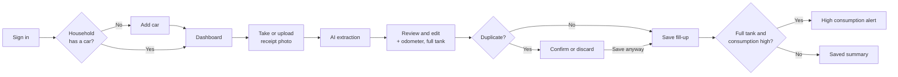

# Product Requirements Document (PRD) — v1

Sep 19, 2026 · @Taviz
Migrated into the canonical documentation structure on 2026-09-29. Source: `Tanqueo — Product Requirements Document.md` (root, pre-migration). [Inferred from codebase: `Tanqueo — Product Requirements Document.md`]

Technical design (system architecture, data model, API contract) has moved to [`docs/architecture/architecture.md`](../architecture/architecture.md) to keep one source of truth per topic. This document stays product-focused.

## 1. Product Overview

Tanqueo is a responsive web app (PWA) that turns a photo of a gas receipt into a fuel log and a simple per-car dashboard for a household in Ontario, Canada.

## 2. Problem Statement

Tracking fuel spending by hand is tedious, so it doesn't happen. Receipts get lost, and there is no easy way to know real fuel consumption, which station is cheapest, or whether a car suddenly burns more fuel than usual.

## 3. Goals

- Log a fill-up in under 30 seconds: photo, review, save.
- Show monthly spend, real consumption (L/100 km), average price (¢/L), cost per km and spend by station.
- Share cars and fill-ups across a household (2–4 people).
- Warn about abnormal consumption and duplicate receipts at save time.
- Keep the architecture product-ready (household as tenant, isolated extraction) while staying small and cheap.

## 4. Explicit Non-Goals

MVP does not include:

- Native iOS/Android apps or app-store distribution.
- Live gas prices or nearby-station search.
- Maintenance tracking, budgets, per-person spend or multi-currency.
- Public sign-up, billing or multi-household admin tooling.

## 5. Users & Personas

The MVP serves one household of 2–4 adults who share one or more cars and log fill-ups from their phones at the pump.

| Persona | Context | Needs |
| --- | --- | --- |
| Household owner | Sets up the app, adds cars, invites others | Accurate history, dashboard, low cost |
| Household member | Fills up a shared car, often in a hurry | Fast capture, no duplicate entries |

**Locale.** UI in English. Currency CAD. Fuel in litres, price shown in ¢/L as on Ontario pumps and receipts. Distance in km, consumption in L/100 km.

**Scope at a glance**

| Area | MVP | Later |
| --- | --- | --- |
| Cars | Add, edit, pick active car; auto-fill fuel type and official consumption | VIN lookup, archive cars |
| Receipts | Camera or gallery upload, AI extraction, manual fallback | Async queue, batch upload |
| Fill-ups | Review, edit, delete; odometer and full-tank flag | Notes, trip tags |
| Dashboard | Monthly spend, consumption, avg price, cost/km, price trend, stations | Year view, CSV export |
| Alerts | High consumption, duplicate receipt | Maintenance reminders |
| Household | Invite by link, shared data | Roles beyond owner/member |

## 6. Core User Journeys

Every fill-up belongs to a car, so the first run always starts by adding a car; after that, logging a receipt is photo → review → save.

The flow reads left to right: setup once, then a short loop per fill-up that ends with the two save-time checks.

1. **Add car.** Enter make, model, year and plate. The app looks up fuel type and official combined consumption; the user confirms or edits, then saves.
2. **Scan receipt.** Choose the target car (defaults to the active one), take a photo or pick from the gallery. Extraction runs synchronously in a few seconds.
3. **Review.** Extracted fields are prefilled; low-confidence fields are highlighted. The user enters the odometer (never on the receipt) and ticks "Filled the tank". If extraction fails, all fields are entered manually.
4. **Duplicate check.** Before saving, a likely duplicate opens a sheet with the existing fill-up and who logged it. Default action: don't save.
5. **Save and consumption check.** For full-tank fill-ups, consumption is computed and compared with the car's recent average; a high result shows the alert with common causes.
6. **Dashboard and history.** Per-car dashboard and a month-grouped history; tapping a fill-up opens it for editing.

## 7. Functional Requirements

Requirements are numbered for traceability; all are MVP unless marked otherwise.

| ID | Area | Requirement |
| --- | --- | --- |
| FR-01 | Auth | Users sign in with a Microsoft or GitHub account (Static Web Apps built-in auth). |
| FR-02 | Household | The first sign-in creates a household with the user as owner. |
| FR-03 | Household | The owner can create a single-use invite link (expires in 7 days); accepting it adds a member. |
| FR-04 | Household | All members see and edit every car and fill-up in the household. |
| FR-05 | Cars | Add a car with make, model, year (1990–current+1) and plate; plate unique per household. |
| FR-06 | Cars | On add, look up fuel type and official combined L/100 km from the NRCan Fuel Consumption Ratings dataset; show the match for confirmation; allow manual entry if no match. |
| FR-07 | Cars | The app keeps an active car per user; the header shows it and lets the user switch. |
| FR-08 | Receipts | Capture a photo with the device camera or pick an image (JPEG/PNG/HEIC, max 10 MB); resize client-side to max 2000 px before upload. |
| FR-09 | Receipts | Upload goes directly to Blob Storage with a short-lived SAS URL issued by the API. |
| FR-10 | Extraction | Extract station, date, litres, price per litre (¢/L), total (CAD) and a per-field confidence using a vision model with structured outputs. |
| FR-11 | Extraction | Store the model's raw JSON, model name and prompt version for every receipt. |
| FR-12 | Extraction | If extraction fails or times out (20 s), open the review form empty; the fill-up can still be saved. |
| FR-13 | Review | Prefill fields; highlight any field with confidence below 0.8. |
| FR-14 | Review | Require odometer (km); reject values lower than the car's previous odometer reading. |
| FR-15 | Review | Validate litres × price ≈ total (±$0.05) and warn if not. |
| FR-16 | Duplicates | Before saving, flag a likely duplicate (see `docs/architecture/architecture.md` for the matching rule) and let the user discard or save anyway. |
| FR-17 | Consumption | For full-tank fill-ups, compute consumption since the previous full tank and show it on the saved summary. |
| FR-18 | Alerts | If consumption exceeds the car's baseline by 15% or more, show the high-consumption alert with common causes. |
| FR-19 | Alerts | The user can mark a fill-up as a one-off; it is then excluded from baselines and averages. |
| FR-20 | Dashboard | Per car: this month's spend, fill-up count and litres; consumption (latest vs official); average ¢/L this month; cost per km; price per litre over the last 8 fill-ups; spend by station over 90 days with the cheapest average flagged; spend per month (last 4). |
| FR-21 | History | List fill-ups grouped by month with monthly totals; filter all vs full tank only; show a Full/Partial badge. |
| FR-22 | History | Open, edit and delete a fill-up; show the receipt photo. Deleting removes the photo too. |
| FR-23 | Layout | Responsive: phone (≥360 px) with header tabs; desktop (≥1024 px) with a multi-column dashboard and a recent fill-ups table. |
| FR-24 | PWA | Installable (manifest + service worker); app shell loads offline; data requires a connection. |

## 8. Non-Functional Requirements

| ID | Category | Requirement |
| --- | --- | --- |
| NFR-01 | Tenancy | Every table carries `household_id`; the API derives it from the caller's membership, never from the request. Every query filters by it. |
| NFR-02 | Security | Blob container is private; upload and read use SAS URLs valid ≤ 10 minutes, scoped to one blob. |
| NFR-03 | Security | Database password lives only in app settings; TLS required; firewall allows Azure services only. |
| NFR-04 | Privacy | Data stored in Canada Central. No receipt data is used beyond extraction; model provider does not retain it (Azure OpenAI). [Assumed: per current Azure OpenAI data-use terms — see `docs/privacy/taste-profile.md` for the unresolved verification item.] |
| NFR-05 | Performance | Extraction p95 ≤ 10 s; dashboard load p95 ≤ 1.5 s on 4G. |
| NFR-06 | Cost | Monthly run cost ≤ $5 USD during the Azure free year; budget alert at $5. |
| NFR-07 | Accessibility | WCAG 2.2 AA: 4.5:1 text contrast, 44 px touch targets, labelled inputs, keyboard navigable. |
| NFR-08 | Reliability | Daily automated DB backups (7-day retention); a failed extraction never blocks saving. |
| NFR-09 | Observability | Application Insights for API errors and extraction latency; extraction accuracy measured from stored AI vs final values. |
| NFR-10 | Maintainability | TypeScript end to end, shared types between web and API; DB access in one module; extraction behind one interface. |

## 9. Success Metrics (KPIs)

No dedicated KPI section existed in the source document; the following are the closest evidence-backed success criteria, drawn from the original "Definition of done" and NFR targets. [Inferred from codebase: source PRD's "Risks, milestones and done" section.]

- Two household members can log fill-ups for two cars from their phones.
- ≥ 90% of extracted fields correct before edits, measured across 20 real Ontario receipts.
- Computed consumption matches a hand calculation for 5 consecutive full tanks.
- Duplicate and high-consumption checks trigger on test cases and stay quiet otherwise (no false positives in testing).
- No API call can read or write another household's data (tested).
- Lighthouse accessibility score ≥ 95 on phone.
- Running cost ≤ $5 USD/month.

`[Open question: no adoption/retention targets exist beyond the household itself, since this is a single-household tool, not a multi-tenant product. Confirm this is intentional before treating KPIs as final.]`

## 10. Constraints

- **Technical.** Azure Static Web Apps' managed Functions do not support managed identity; the API connects to PostgreSQL with a password until an upgrade to SWA Standard + a linked Function App (Flex Consumption). See `docs/architecture/architecture.md` Evolution Strategy.
- **Operational.** Single household of 2–4 members; no multi-household or admin tooling in MVP (see Non-Goals).
- **Cost.** Must run at ≤ $5 USD/month during the Azure free year (NFR-06); this bounds compute, storage and model usage choices.
- **Data residency.** All data stored in Canada Central (NFR-04).
- **Locale.** English UI, CAD currency, metric units — no localization work planned for MVP.
- **Stack decision (2026-09-29).** The product architecture in this PRD (Azure Static Web Apps, Functions, PostgreSQL Flexible Server, Blob Storage, Azure OpenAI) is the confirmed, vigente decision for this project, overriding the generic Next.js/Supabase default stack described in the ambient engineering `AGENTS.md`. See `AGENTES.md` (repo root) for the explicit override note and its scope.

## 11. Risks & Mitigations

The main risk is extraction quality on faded thermal receipts; the review screen and manual fallback keep it from blocking anyone.

| Risk | Impact | Mitigation |
| --- | --- | --- |
| Faded or crumpled receipts | Wrong or missing fields | Confidence highlights, litres × price check, manual entry |
| Wrong odometer entry | Bad consumption and false alerts | Reject values below the previous reading; 50 km minimum distance |
| Irregular fill habits (many partials) | Few consumption data points | Consumption only between full tanks; alert needs 3 prior values |
| Postgres cost after the free year | ~$15–20 USD/month | Budget alert; `pg_dump` to another Postgres if needed |
| DB reachable from all Azure services | Wider attack surface | Strong password, TLS, upgrade path to managed identity |
| Model or API change | Extraction breaks | `ReceiptExtractor` interface; stored prompt version to compare |

## 12. Roadmap & Phases

| # | Milestone | Scope |
| --- | --- | --- |
| M1 | Foundations | Repo, SWA + Functions deploy, Postgres, migrations, auth, household auto-create |
| M2 | Cars | NRCan import, add/edit/switch car |
| M3 | Receipts | SAS upload, extraction, review form, save |
| M4 | Dashboard and history | All FR-20/21/22 figures and screens, responsive layouts |
| M5 | Smart checks | Duplicate check, consumption, high-consumption alert, one-off |
| M6 | Polish | PWA install, invites, accessibility pass, App Insights, budget alert |

Status as of 2026-09-29: **pre-M1**. The repository contains only the default Vite + React scaffold; no milestone work has started. [Inferred from codebase: `src/App.tsx` is the unmodified `create-vite` template.]

## 13. Assumptions & Open Questions

**Open questions (carried over from the source document):**

- `[Open question: Invite by link only, or also by email address?]`
- `[Open question: Keep receipt photos forever, or delete after 12 months?]`
- `[Open question: Should the high-consumption alert also appear on the dashboard until dismissed?]`

**Open questions (raised during documentation migration):**

- `[Open question: The generic ambient AGENTS.md requires PostgreSQL RLS for authorization. This PRD's tenancy model (NFR-01) enforces household scoping in application code, not database RLS. Decide whether to add RLS as defense-in-depth or formally accept the app-layer-only approach — see ADR-0003.]`
- `[Open question: No dependency on Vitest/Playwright exists yet in package.json despite the ambient AGENTS.md mandating them for testing. Confirm whether test tooling gets added at M1 (Foundations) or is deferred.]`

**Assumptions:**

- `[Assumed: "household" always means the single MVP household — no multi-tenant SaaS ambitions are in scope for this version.]`
- `[Assumed: @Taviz is the product owner and primary/only developer, based on document authorship and single-maintainer repository state.]`
